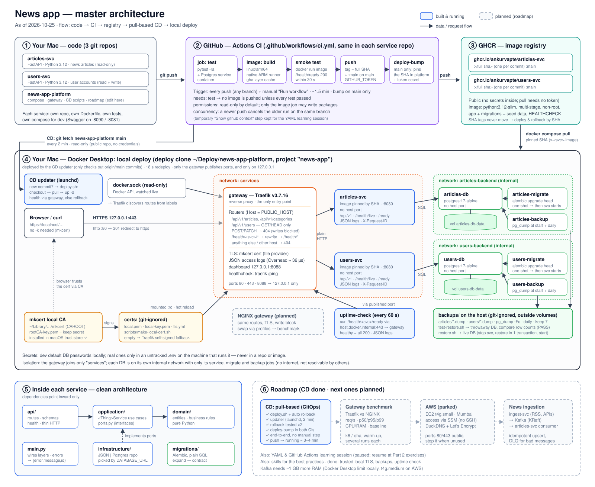

# news-app-platform

System-level repo for the news app: everything that belongs to the app as a
whole rather than to one service. Services never depend on this repo; this
repo depends on them.



Master diagram of the whole system (code → CI → registry → local deploy, plus
what's planned). Solid boxes are built and running; dashed boxes are planned.
Source: [`docs/architecture.svg`](docs/architecture.svg), picture: [`docs/architecture.png`](docs/architecture.png).

## What lives here
| Path | Purpose |
|---|---|
| `CLAUDE.md` | Shared architecture rules, container checklist and roadmap for every service |
| `docker-compose.yml` | Runs the whole app from pinned GHCR images behind the Traefik gateway |
| `docs/architecture.svg` | Master architecture diagram (+ `.png`), updated on request |
| `scripts/make-local-cert.sh` | Creates the trusted local HTTPS certificate (mkcert) in `certs/` |
| `scripts/pg-backup.sh` | Backup job (runs inside `articles-backup` / `users-backup`) |
| `scripts/test-restore.sh`, `scripts/restore.sh` | Prove a backup restores; restore one into the live database |
| `scripts/uptime-check.sh` | Scheduled health check through the gateway (runs inside `uptime-check`) |
| NGINX gateway | *(planned)* Second gateway option, to benchmark against Traefik |
| Kafka (in `docker-compose.yml`) | *(planned)* Message broker between `ingest-svc` and articles-svc for news from external sources |

## Services
| Service | Repo | Capability | Image |
|---|---|---|---|
| articles-svc | [articles-svc](https://github.com/ankurvapte/articles-svc) | News articles (read-only) | `ghcr.io/ankurvapte/articles-svc` |
| users-svc | [users-svc](https://github.com/ankurvapte/users-svc) | User accounts/profiles (read + write) | `ghcr.io/ankurvapte/users-svc` |

Each service owns its data and is built, tested and pushed by its own repo's CI
(`linux/arm64` images, one tag per commit SHA). They never read each other's
data; cross-service calls go over HTTP.

```
 client ─https─▶ gateway (Traefik, 127.0.0.1:80/443)      ← the only published ports
                  ├─ /api/v1/articles, /api/v1/categories ─▶ articles-svc ─▶ articles-db
                  ├─ /api/v1/users  (GET/HEAD only)       ─▶ users-svc    ─▶ users-db
                  └─ /health/<svc>/{live,ready}           ─▶ that service's /health/*
```

## Run everything (local deploy)
No service repo needs to be cloned: compose pulls the pinned images from GHCR.
```bash
docker compose up -d
docker compose ps
curl https://localhost/health/articles/ready
curl https://localhost/health/users/ready
curl "https://localhost/api/v1/articles?page_size=2"
docker compose down        # add -v to also delete both database volumes
```
- Needs trusted local HTTPS (below). Without it Traefik serves its self-signed
  default certificate, and curl needs `-k` (browsers show a warning).
- Traefik dashboard (routers, services, middlewares): http://localhost:8088/dashboard/
- All three ports are bound to `127.0.0.1`, so nothing outside this machine can reach them.

## Trusted local HTTPS (mkcert)
[mkcert](https://github.com/FiloSottile/mkcert) creates a small certificate
authority (CA) on this Mac, adds it to the macOS trust store, and signs a
certificate for `localhost` with it. Traefik then serves that certificate.

One-time setup:
```bash
# 1. Install mkcert (no Homebrew here: the release binary in ~/.local/bin)
curl -fsSL -o ~/.local/bin/mkcert https://github.com/FiloSottile/mkcert/releases/download/v1.4.4/mkcert-v1.4.4-darwin-arm64
chmod +x ~/.local/bin/mkcert
# 2. Trust its CA (asks for your password)
mkcert -install
# 3. Create the certificate; the running gateway picks it up, no restart needed
./scripts/make-local-cert.sh
```
- The certificate lands in `certs/` (git-ignored, mounted read-only into the gateway).
  Delete `certs/` and Traefik falls back to its self-signed default.
- Browsers and macOS's `/usr/bin/curl` use the macOS trust store, so they just work.
  Python (and Homebrew curl) use their own CA list; point them at mkcert's CA:
  `SSL_CERT_FILE="$(mkcert -CAROOT)/rootCA.pem" python3 ...`
  or `curl --cacert "$(mkcert -CAROOT)/rootCA.pem" https://localhost/...`
- Keep `$(mkcert -CAROOT)/rootCA-key.pem` private: anyone with it can create
  certificates this Mac trusts for any site. `mkcert -uninstall` removes the CA.

## Backups and restore
```
 articles-db ◀─pg_dump─ articles-backup ─▶ backups/articles/articles-<UTC time>.dump
 users-db    ◀─pg_dump─ users-backup    ─▶ backups/users/users-<UTC time>.dump
                                                │
            test-restore.sh ─▶ throwaway Postgres (no network) ─▶ compare row counts with live
            restore.sh      ─▶ live DB (stop service → restore in one transaction → start)
```
- `articles-backup` and `users-backup` back up their own database once at start
  and then every `BACKUP_INTERVAL_SECONDS` (86400 = daily), keeping the newest
  `BACKUP_KEEP` (7). Each sits only on its database's backend network.
- Dumps go to `backups/` on the host (git-ignored), outside the Docker volumes, so
  `docker compose down -v` doesn't delete them. Format: `pg_dump -Fc` (compressed,
  restorable with `pg_restore`).
- They only run while Docker is running; a sleeping Mac takes no backups.

```bash
docker compose exec users-backup pg-backup            # back up now
ls backups/users                                       # list backups
./scripts/test-restore.sh users                        # prove the newest one restores (live DB untouched)
./scripts/restore.sh users backups/users/<file>.dump   # replace live data (asks to confirm)
docker compose logs users-backup                       # JSON lines: backup written / old backup deleted
```
`restore.sh` stops `users-svc` (a few seconds of 503/404 at the gateway), restores
in a single transaction (a failed restore leaves the old data), then starts it again.

## Health check through the gateway
```
 uptime-check ──every 60 s──▶ https://localhost/health/articles/ready ─┐
 (curl, own container)        https://localhost/health/users/ready    ─┤
                                     │ connects to host.docker.internal:443
                                     ▼ = this Mac's 127.0.0.1:443, same host name + TLS as a real client
                              Docker port forwarding ─▶ gateway ─▶ articles-svc / users-svc ─▶ DB readiness
```
- `uptime-check` (curlimages/curl) checks every service in `CHECK_SERVICES` every
  `CHECK_INTERVAL_SECONDS` (60), verifying the TLS certificate with mkcert's CA
  (`certs/rootCA.pem`). It connects to `CHECK_VIA` (default
  `host.docker.internal:443`, the Mac's published port), so a broken port
  binding, gateway, route, certificate, service or database all show up as "down".
  `CHECK_VIA=gateway:443` would test only from the gateway inwards.
- `docker compose ps` shows `uptime-check` as **healthy** only while every service
  answered 200 on the last round; **unhealthy** means something is down.
- Logs (JSON) stay quiet while all is well: `ERROR service is down` when a service
  goes down, `WARNING service still down` on each further failed check,
  `INFO service is back up` when it recovers.

```bash
docker compose ps uptime-check                   # healthy / unhealthy
docker compose logs -f uptime-check              # down / back up events
CHECK_INTERVAL_SECONDS=5 docker compose up -d uptime-check   # check faster while testing
```
It runs on the same machine as the app, so it can't report a dead Mac or Docker;
the external uptime check on AWS covers that later.

## Deploy a new version
1. Push to a service repo; its CI tests, builds and pushes `ghcr.io/ankurvapte/<svc>:<full sha>`.
2. Put that SHA in the `x-<svc>-image` line at the top of `docker-compose.yml`.
3. `docker compose up -d`: only that service (and its migrate job) is recreated.

Roll back by putting the previous SHA back and running `docker compose up -d` again.
Never deploy `:main`; it moves on every push. To try a change before pushing,
run that service's own compose file from its repo (`docker compose up --build`).

## Gateway rules
- HTTP redirects to HTTPS. Requests for any other host than `PUBLIC_HOST`
  (default `localhost`) get Traefik's 404.
- users-svc is read-only from outside: it has no auth yet, so only `GET`/`HEAD`
  are routed, and `POST`/`PATCH` get a 404 from the gateway.
- Health checks go through the gateway as `/health/<svc>/live|ready`, rewritten
  to the service's own `/health/*`.
- Swagger (`/docs`) is not exposed through the gateway; use a service's own compose for it.
- Gateway 404s are Traefik's plain text, not the `{error, message, request_id}` body.
- Access logs are JSON on stdout (`docker compose logs gateway`). `Overhead` is
  the time Traefik itself added, in nanoseconds; useful for the gateway benchmark later.

Notes:
- Stop each service's own compose (`docker compose down` in its folder) first,
  or its host port and containers will clash with names here.
- Each service has its own Postgres container and volume (`news-app_articles-db-data`,
  `news-app_users-db-data`). `docker compose down -v` resets both to the seed data.
- Look inside: `docker compose exec users-db psql -U users -c "SELECT * FROM users"`
  or `docker compose exec articles-db psql -U articles -c "SELECT slug FROM articles"`
- Network isolation: each database sits on its own `internal` network
  (`articles-backend`, `users-backend`) shared only with its service, so no other
  container can resolve or reach it, and databases have no internet access.
  Services and the gateway meet on the `services` network.
- Migrations: `articles-migrate` and `users-migrate` are one-shot jobs that run
  `alembic upgrade head` before their service starts. They show as `Exited (0)`
  in `docker compose ps -a`; that's expected. If one fails, its service doesn't
  start: check `docker compose logs users-migrate`.
- The gateway reads the Docker socket (read-only) to discover containers by their
  `traefik.*` labels. That access is powerful; never publish the dashboard port beyond `127.0.0.1`.

## Claude Code
Claude Code reads `CLAUDE.md` from parent folders, so `~/Projects/CLAUDE.md`
is a symlink to `news-app-platform/CLAUDE.md`. On a fresh machine:
```bash
ln -s news-app-platform/CLAUDE.md ~/Projects/CLAUDE.md
```
